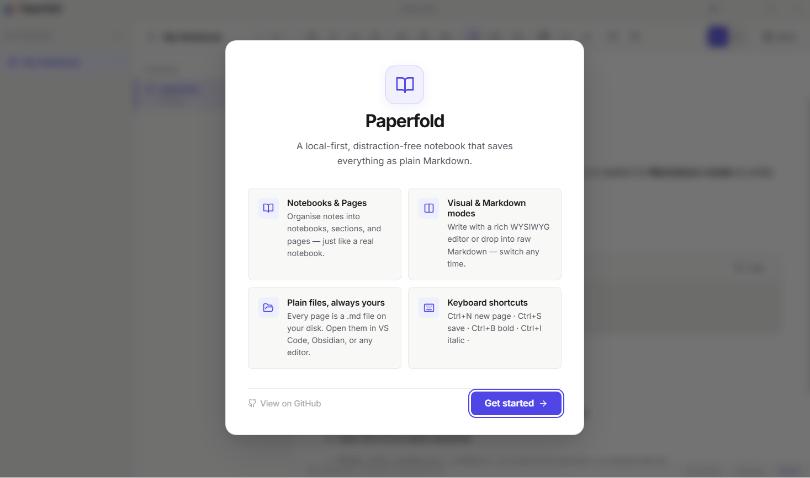

# Paperfold

A local-first, Markdown-native notebook app. All notes save as `.md` files on your disk.



## Features

- **Visual mode** — click and type like Word/Google Docs (no Markdown needed)
- **Markdown mode** — write raw `.md` syntax with toolbar shortcuts
- Switch modes anytime — they stay in sync
- OneNote-style sidebar: Notebooks → Sections → Pages
- **Inline rename & delete** — right-click any notebook, section, or page
- **Title editing** — edit the page title and the file is renamed on disk
- Real `.md` files on disk — fully portable
- Code blocks with custom language selector & clean text copy button
- Task lists with custom checkboxes
- Auto-save with 800ms debounce
- Custom title bar with minimize/maximize/close
- Dark mode support
- Accurate word count (Markdown syntax excluded)

## Getting Started

### Prerequisites
- Node.js 18+
- npm 9+

### Install & Run

```bash
cd paperfold
npm install
npm run dev
```

This opens the Electron window with hot-reload.

### Build for Windows

```bash
npm run build
```

Produces a `.exe` installer in the `release/` folder.

## File Structure

```
paperfold/
├── electron/
│   ├── main.js          # Electron main process (window, IPC, file system)
│   └── preload.js       # Secure bridge between Electron and React
├── src/
│   ├── components/
│   │   ├── TitleBar.jsx         # Custom draggable title bar
│   │   ├── NotebookSidebar.jsx  # Left sidebar — notebook list (with rename/delete)
│   │   ├── PageSidebar.jsx      # Middle sidebar — sections & pages (with rename/delete)
│   │   ├── Editor.jsx           # Main editor (TipTap + raw MD)
│   │   └── Toolbar.jsx          # Context-aware toolbar
│   ├── styles/
│   │   └── global.css           # CSS variables, Inter font, dark mode
│   ├── App.jsx                  # Root component + state + all handlers
│   └── main.jsx                 # React entry point
├── index.html
├── vite.config.js
└── package.json
```

## Notes Storage

By default, notebooks are stored in:
```
Documents/Paperfold/<NotebookName>/<SectionName>/<page-title>.md
```

You can change the folder via **File → Open Notebook Folder…**

## Tech Stack

| Layer | Library |
|-------|---------|
| Shell | Electron 42 |
| UI | React 18 + Vite 8 |
| WYSIWYG Editor | TipTap 2 |
| Syntax Highlighting | lowlight + highlight.js |
| MD → HTML | marked |
| HTML → MD | Turndown |
| Persistence | electron-store |
| Icons | lucide-react |
| Typography | Inter (Google Fonts) |
